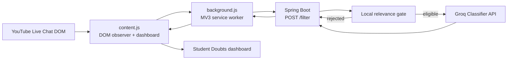
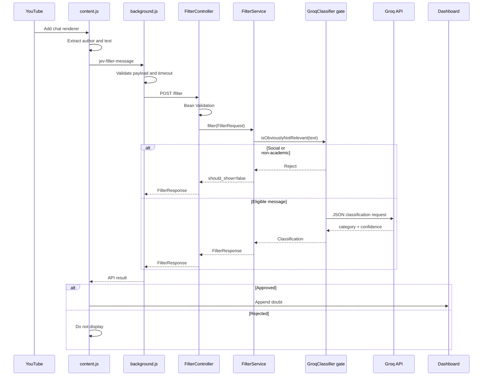
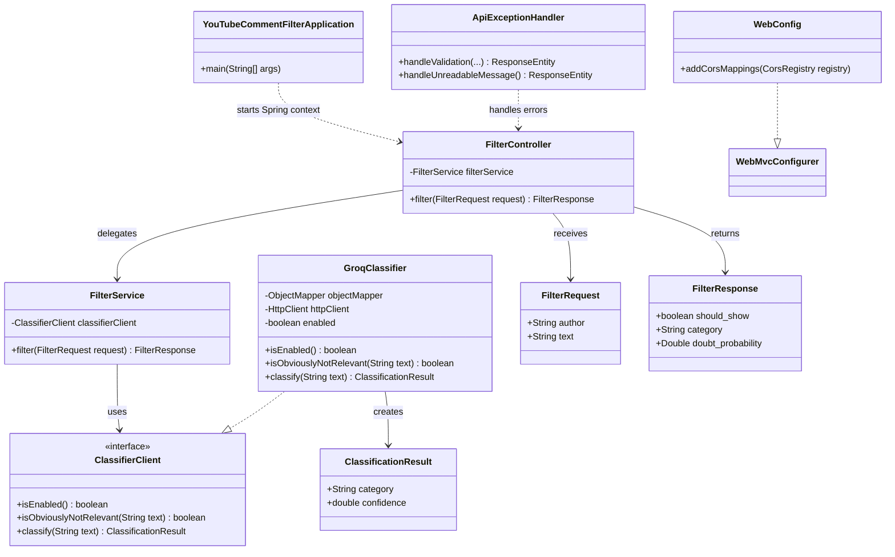
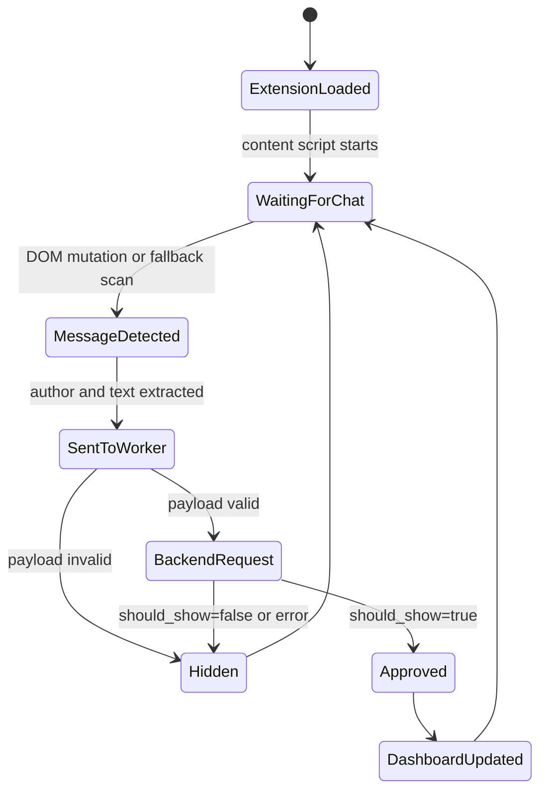
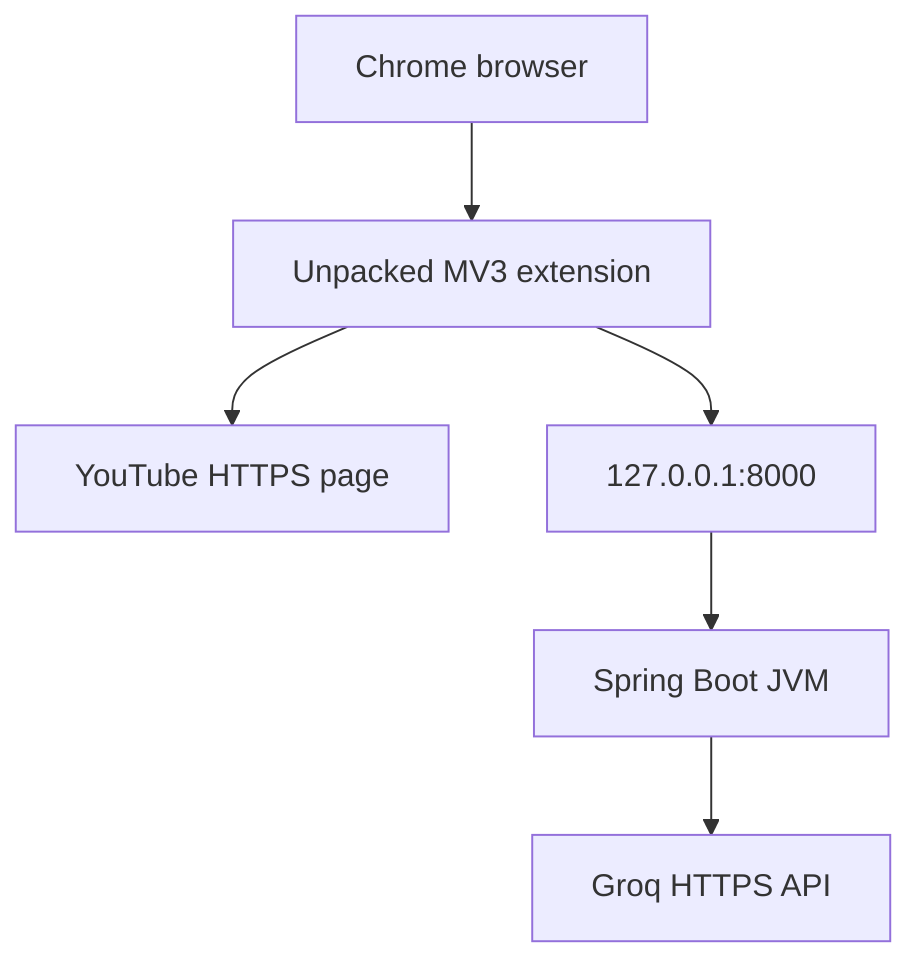

# UML and Architecture Diagrams

The diagrams use Mermaid syntax. They render in GitHub, VS Code Markdown
preview, and other Mermaid-compatible viewers.

## 1. Component Diagram

## 2. Sequence Diagram

## 3. Backend Class Diagram

## 4. Extension Runtime Diagram

## 5. Deployment View

